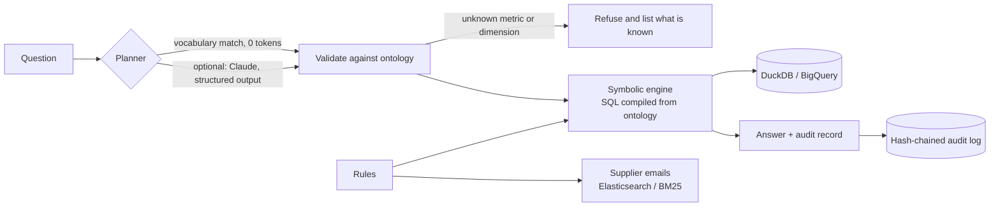

# Ontology Agent Demo

[](https://github.com/jeshuasalazar/ontology-agent-demo/actions/workflows/ci.yml)

**Deterministic, auditable answers over enterprise data, with near-zero LLM tokens.**

Most "AI for the enterprise" sends business data to an LLM on every question and hopes the
answer is right. That costs tokens on every call and gives different answers to the same
question. It also leaves an auditor nothing to check.

This project inverts that. A **business ontology** defines every metric and rule once, in
versioned YAML. A **symbolic engine** computes from that definition. The neural layer only
translates a question into a structured query, and it can be switched off. The result:

| | Ontology-first (this repo) | LLM-only, estimated floor |
|---|---|---|
| LLM tokens per question (10-question golden set) | **0** | ~3,600 (raw data alone) |
| Same question, same data → same answer | **Always** (hash-verified) | No guarantee |
| Evidence for every number | Ontology version, formula hash, SQL, data hash | Model output |
| Invoice run (6 CFDI 4.0) | **0 tokens, ~5 ms**, same decisions as the LLM agent | ≥ 2,230 input tokens per run |

The numbers come from `uv run python eval/run_eval.py`. The LLM-only column is an estimate
(~4 characters per token) and covers only the data a model would need to read. Instructions,
reasoning and output would add to it, on every call.

## Architecture



- **`ontology/retail.yaml`**: entities, facts, dimensions and 5 metrics (days of inventory,
  sell-through, gross margin, revenue, units), each with its exact SQL. Change a definition
  and its fingerprint changes, so every past answer still says which formula it used.
- **`engine.py`**: compiles a `Query` into parameterized SQL for **DuckDB** (local) or
  **BigQuery** (same SQL, `@param` placeholders). It rejects anything the ontology does not
  define instead of guessing.
- **`agent.py`**: a **LangGraph** workflow: `plan → validate → compute → answer`, or
  `clarify`. Only the optional LLM planner can spend tokens, and only when the ontology's
  vocabulary cannot map the question.
- **`retrieval.py`**: unstructured data. Lead times live in supplier emails, not in the
  warehouse. **Elasticsearch** (or a pure-Python BM25 fallback) finds the email, and a
  deterministic extractor reads the *current* value ("pasa de 14 a 21 días" → 21) and cites
  the source file.
- **`rules.py`**: `reorder_needed` = days of inventory < supplier lead time + 7 safety days.
  Each decision carries its evidence. With no evidence, it escalates to a human instead of
  assuming.
- **`payables.py`** + **`ontology/accounts_payable.yaml`**: CFDI 4.0 invoice
  reconciliation. Checks include voucher type (a credit note is never paid), currency,
  receiver RFC, totals to the cent net of discounts, IVA at 16% line by line with the SAT's
  per-concept rounding (rate 0 and exempt lines pass), duplicate fiscal folio and approved
  supplier. Payments are scheduled by due date within budget, and fixed-day terms roll to the
  next month and clamp to month end. It reproduces the decisions of an LLM agent that did the
  same job: 3 to pay, 2 to clarify, 1 duplicate, $32,190 scheduled, $7,810 left. It does so
  with zero tokens.
- **`audit.py`**: append-only JSONL with a SHA-256 hash chain. `GET /audit/verify` detects
  any edit to a past record.
- **`api.py`**: **FastAPI** with `/ask`, `/metrics`, `/rules/reorder`, `/payables/run`,
  `/audit/{id}`, `/audit/verify` and `/ontology`.

## Quick start

```bash
uv sync
uv run pytest                      # values vs. independent Python, determinism, rules, audit, API
uv run python eval/run_eval.py     # planner accuracy + token bill
uv run uvicorn ontology_agent_demo.api:app --reload
curl -s localhost:8000/ask -H 'content-type: application/json' \
  -d '{"question": "¿Cuántos días de inventario tenemos por región?"}'
```

With Docker (API + Elasticsearch):

```bash
docker compose up -d --build
curl -s localhost:8080/health        # {"retriever": "elasticsearch", ...}
ELASTICSEARCH_URL=http://localhost:9200 uv run --extra elastic pytest   # parity test
```

On Google Cloud:

```bash
./scripts/load_bigquery.sh <project>          # BigQuery sandbox is enough
BIGQUERY_PROJECT=<project> uv run --extra bigquery uvicorn ontology_agent_demo.api:app
./scripts/deploy_cloud_run.sh <project>       # Cloud Run (billing required)
```

Optional LLM planner: `uv sync --extra llm` and set `ANTHROPIC_API_KEY`. Its structured
output goes through the same validation, so the model chooses *what* to compute, never *what
the numbers are*.

## Design decisions

- **Definitions are data, not prompts.** "Days of inventory" means one thing: units on hand ÷
  average daily units over 28 days. It is null, not infinite, when there were no sales. That
  definition is reviewed like code and versioned.
- **Refuse rather than guess.** Unknown metrics return 422. Questions outside the ontology
  get a list of what *can* be answered.
- **Evidence over confidence.** Every number has a record covering the ontology version, the
  metric fingerprint, the SQL, the parameters, the data fingerprint and the result hash.
- **Tokens only at the edges.** Marginal cost per question tends to zero, so usage can scale
  to any number of users without a token budget.
- **Runs where the data lives.** Nothing leaves the process except optional, explicit LLM
  calls, which makes the stack easy to deploy behind a client's firewall.

## Data

All data is synthetic and fictitious. `scripts/generate_data.py` regenerates it from a fixed
seed. It covers 3 stores (CDMX, Guadalajara, Monterrey), 8 air-conditioning SKUs from
3 suppliers, 120 days of sales and inventory, and 6 sample CFDI 4.0 invoices.

## Limitations

The deterministic planner covers the vocabulary in `planner.py`, and broader phrasing needs
the LLM planner. The metric SQL targets DuckDB and BigQuery. Retrieval is lexical (BM25), and
hybrid vector search is the natural next step. Payables reads the invoice XML as given: it
does not check the SAT cancellation status or validate the seal, which a production run would
do against the SAT web service before paying. This is a demonstration, not a production
system.
